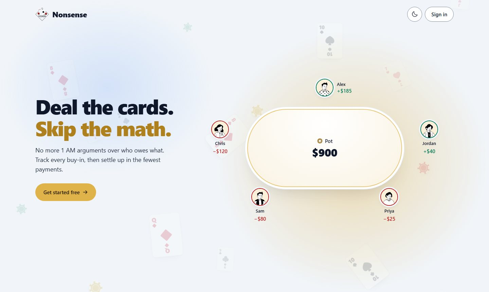
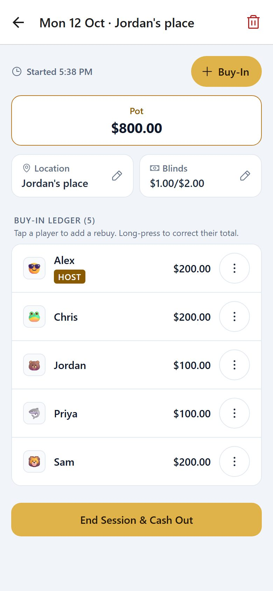
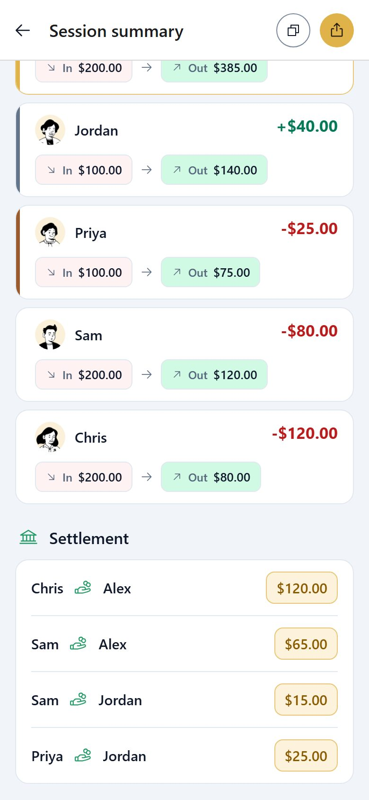
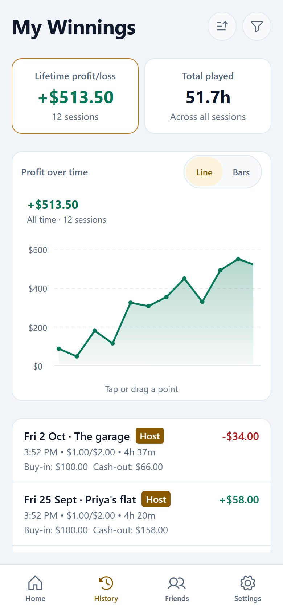
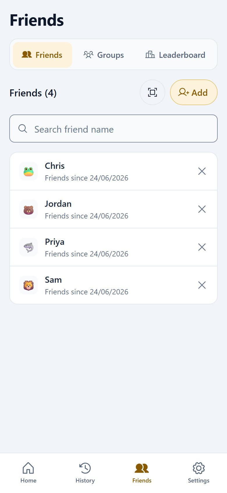
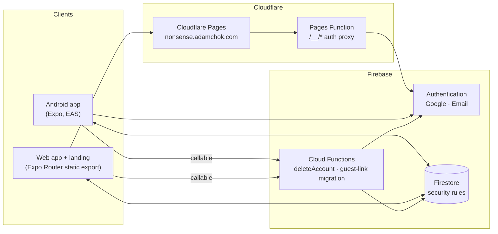

<div align="center">

<picture>
  <source media="(prefers-color-scheme: dark)" srcset="assets/images/logo-mark.png">
  
</picture>

# Nonsense

**Deal the cards. Skip the math.**

The home poker tracker for people who play with friends: log every buy-in as it happens,<br>
cash out in seconds and settle up in the fewest possible payments.

[](https://github.com/adamchok/Nonsense/actions/workflows/ci.yml)


[**Open the web app**](https://nonsense.adamchok.com) · [Features](#features) · [Quick start](#quick-start) · [Architecture](#architecture) · [Deployment](#deployment)

<br>

<picture>
  <source media="(prefers-color-scheme: dark)" srcset="doc/readme/landing-dark.jpg">
  
</picture>

</div>

---

## Contents

- [Why Nonsense](#why-nonsense)
- [Features](#features)
- [Tech stack](#tech-stack)
- [Architecture](#architecture)
- [Quick start](#quick-start)
- [Scripts](#scripts)
- [Testing](#testing)
- [Data model and security](#data-model-and-security)
- [Deployment](#deployment)
- [Demo recordings](#demo-recordings)
- [Privacy and legal](#privacy-and-legal)
- [Contributing](#contributing)
- [License](#license)

## Why Nonsense

Home games run on trust and a notes app. By 1 AM nobody remembers who rebought twice, the totals don't add up, and someone is doing long division on a napkin. Nonsense replaces the napkin:

- **One shared ledger.** Every buy-in, rebuy and early cash-out is recorded live, so the whole table sees the same numbers.
- **Settle-up that minimises payments.** Enter final stacks; Nonsense works out each player's result and the smallest set of transfers that squares the table.
- **History that adds up.** Every night feeds a profit chart, lifetime stats, and friend and group leaderboards.
- **Records only.** Nonsense never touches money. Payments happen however your table likes to pay.

## Features

<table>
  <tr>
    <td align="center" width="25%">
      <picture>
        <source media="(prefers-color-scheme: dark)" srcset="public/media/live-session.jpg">
        
      </picture>
      <br><b>Run the game</b>
    </td>
    <td align="center" width="25%">
      <picture>
        <source media="(prefers-color-scheme: dark)" srcset="public/media/settle-up.jpg">
        
      </picture>
      <br><b>Settle up</b>
    </td>
    <td align="center" width="25%">
      <picture>
        <source media="(prefers-color-scheme: dark)" srcset="public/media/history.jpg">
        
      </picture>
      <br><b>See your history</b>
    </td>
    <td align="center" width="25%">
      <picture>
        <source media="(prefers-color-scheme: dark)" srcset="public/media/friends.jpg">
        
      </picture>
      <br><b>Play with friends</b>
    </td>
  </tr>
</table>

### At the table

- **Cash or chip games.** Chip sessions store a chip value and convert results to money at the end.
- **Quick-pick amounts that fit the stakes.** Buy-in and cash-out shortcuts scale with the blinds (a full buy-in is 100 big blinds), so $1/$2 and $25/$50 games both get sensible buttons.
- **Live ledger** with rebuys, edits, early cash-outs and undo.
- **Guest players** for friends without an account, linkable to a real account later.
- **Saved locations** and blinds per session.

### After the game

- **Settlement** that computes the minimum number of payments, with a podium for the top three.
- **Shareable summary card**, exported as a crisp PNG for group chats.
- **History** with a line or bar profit chart, search (place, date, stakes), filters (date range, location, buy-in, profit) and multi-key sorting.
- **Statistics:** lifetime P/L, win rate, hourly rate, hours played, hosting and attendance trends.

### Friends and groups

- Friend requests by **QR code** or referral code.
- **Groups** for regular tables, with group leaderboards and one-tap "add the whole group" to a new session.
- **Illustrated avatars** (DiceBear Notionists) with a shuffle picker.

### Accounts

- Sign in with **Google** or **email and password** (Firebase password policy, live rule checklist, verification email, enumeration-safe password reset).
- **Change password** with re-authentication.
- **Self-service account deletion** in the app and on the web, as Google Play requires. Personal data is removed immediately; shared sessions stay correct for the other players, with the deleted user shown as "Deleted player".

### Everywhere

- **Android app and responsive web app** from one codebase, with a sidebar layout on wide screens.
- **Light and dark themes** ("midnight gold"), motion that respects reduced-motion settings, skeleton loading states and keyboard-accessible controls.
- **Marketing site** with a product tour, FAQ, Terms, and a Privacy Policy in English and Malay.

## Tech stack

| Layer | Choice |
|---|---|
| App framework | [Expo](https://expo.dev) SDK 57 with [Expo Router](https://docs.expo.dev/router/introduction/) (file-based routes, static web export) |
| UI | React 19, React Native 0.86, React Native Web, Reanimated 4, Phosphor icons, react-native-gifted-charts, react-native-svg |
| Language | TypeScript (strict) |
| Backend | Firebase Authentication, Cloud Firestore, Cloud Functions v2 (`asia-southeast1`) |
| Native | Camera (QR scan), sharing, clipboard, haptics, Google Sign-In, view capture |
| Web hosting | Cloudflare Pages, with a Pages Function proxying Firebase Auth on the site's own domain |
| Mobile delivery | EAS Build (Android) and EAS Update (OTA, fingerprint runtime versions) |
| Quality | ESLint, `tsc`, Node's built-in test runner, Firebase emulators, GitHub Actions |

## Architecture



Clients read and write Firestore directly, guarded by [`firestore.rules`](firestore.rules). Cloud Functions handle only what a client must not do alone: deleting an account across every collection, and migrating a guest's history when they claim a guest link.

### Project structure

```text
app/                  Routes (Expo Router)
  (auth)/             Sign-in, name, secure-your-account
  (tabs)/             Home, History, Friends, Profile
  session/            New, live ledger, cash-out, summary
  change-password.tsx, delete-account.tsx, privacy*.tsx, terms.tsx, contact.tsx
components/           Shared UI (every modal on one ModalShell, charts, avatars, ...)
  session/            Live-session building blocks
  web/                Landing page, site chrome, legal and contact pages
lib/                  Firebase setup, Firestore queries, auth and theme providers,
                      settlement, formatting, legal content
functions/            Cloud Functions (account deletion, guest-link migration)
cloudflare/functions/ Pages Function that proxies Firebase Auth
scripts/              Ops scripts (account merge, guest migration) and demo tooling
test/                 Unit, Firestore rules, auth and Cloud Functions tests
firestore.rules       Security rules
firestore.indexes.json
```

## Quick start

### Prerequisites

- **Node.js 24** and **pnpm 10** (`corepack enable` picks up the version pinned in `package.json`)
- **Java 21** for the Firebase emulators
- A Firebase project with Authentication and Firestore (see [Firebase setup](#firebase-setup)), or just the emulators for local work

### Run against local emulators (no Firebase project needed)

```bash
pnpm install
cp .env.example .env
```

Set `EXPO_PUBLIC_USE_EMULATOR=1` and `EXPO_PUBLIC_FIREBASE_PROJECT_ID=demo-nonsense` in `.env` (the other `EXPO_PUBLIC_FIREBASE_*` values only need to be non-empty), then run each in its own terminal:

```bash
pnpm exec firebase emulators:start --only auth,firestore,functions --project demo-nonsense
```

```bash
node scripts/demo/seed-demo.mjs
```

```bash
pnpm web
```

The seed creates five players with friends, a group, twelve past sessions and one live game. Sign in as `alex@demo.test`; the password is `DEMO_PASSWORD` in [`scripts/demo/seed-demo.mjs`](scripts/demo/seed-demo.mjs). Add `--extra=150` for 150 older sessions to exercise paging and search. Restarting the emulators wipes the data, so seed again afterwards.

`EXPO_PUBLIC_EMULATOR_HOST` changes the emulator host (default `127.0.0.1`; Android emulator `10.0.2.2`; a physical device needs your machine's LAN IP).

### Run against a real Firebase project

1. Fill in every `EXPO_PUBLIC_FIREBASE_*` value in `.env` and leave `EXPO_PUBLIC_USE_EMULATOR` empty.
2. Set `EXPO_PUBLIC_GOOGLE_WEB_CLIENT_ID` for native Google sign-in (steps in [`.env.example`](.env.example)).
3. Run `pnpm start`, then open a development build, the Android emulator or the web.

## Scripts

| Command | What it does |
|---|---|
| `pnpm start` | Expo dev server |
| `pnpm web` / `pnpm android` / `pnpm ios` | Start a specific target |
| `pnpm typecheck` | `tsc --noEmit` |
| `pnpm lint` | ESLint (Expo config) |
| `pnpm test` | Unit tests, no emulators needed |
| `pnpm test:rules` | Firestore security rules tests |
| `pnpm test:auth` | Sign-up, sign-in and account-linking tests |
| `pnpm test:functions` | Cloud Functions tests (account deletion, guest migration) |
| `pnpm build:preview` / `pnpm build:production` | EAS Android build |
| `pnpm update:preview` / `pnpm update:production` | EAS OTA update |
| `pnpm deploy:web` | Export the web app and deploy it to Cloudflare Pages |

## Testing

| Suite | Runs on | Covers |
|---|---|---|
| `test/lib` | Node only | Settlement, amount steps, currency formatting, history filters, auth error messages, share text |
| `test/rules` | Firestore emulator | Who can read and write players, sessions, ledgers and guest links |
| `test/auth` | Auth + Firestore emulators | Email sign-up and sign-in, linking a guest account to Google or email |
| `test/functions` | Firestore emulator | Account deletion (full cleanup, solo vs shared sessions, live-session refusal, idempotency) and guest migration |
| `test/scripts` | Firestore emulator | Account merge and player-removal ops scripts |

Emulator suites run through `firebase emulators:exec` against the `demo-nonsense` project, so they never touch production. [CI](.github/workflows/ci.yml) runs typecheck, lint, unit, rules and auth tests on every push and pull request to `master`.

## Data model and security

```text
players/{uid}                     profile, avatar, refCode
  friends/ friend_requests/ friend_requests_sent/
  saved_locations/ group_memberships/
groups/{groupId}                  owner, member count
  members/
sessions/{sessionId}              host, status, blinds, location, chip value
  buy_ins/ early_cashouts/ results/ session_participants/
refCodes/{code}                   code -> player
guest_links/{id}                  claim a guest's history
```

- Access is keyed on the signed-in uid. Players read only the sessions they take part in and the profiles of people they play with.
- Totals and settlements are derived from the ledger, never typed in.
- Composite indexes live in [`firestore.indexes.json`](firestore.indexes.json); deploy them with `pnpm exec firebase deploy --only firestore:indexes`.

### Account deletion

`deleteAccount` is a callable function that requires a sign-in within the last five minutes. It refuses while the user hosts a live session, then:

1. deletes hosted sessions that no other registered player was in,
2. renames the user to "Deleted player" in every shared session, so the other players' history stays correct,
3. removes friendships, requests, group memberships, owned groups, guest links and the referral code,
4. deletes the player document with all its subcollections, then the Auth user.

It is idempotent: a retry after a partial failure finishes the job.

## Deployment

### Web (Cloudflare Pages)

```bash
pnpm deploy:web
```

This exports the static site, fixes asset paths (`scripts/fix-web-assets.js`; Wrangler skips `node_modules` folders) and deploys from `cloudflare/` so the Pages Function at `cloudflare/functions/__/[[path]].js` ships with it. That function proxies `/__/*` to Firebase Auth, which lets `EXPO_PUBLIC_FIREBASE_AUTH_DOMAIN` be the site's own domain. [`public/_redirects`](public/_redirects) maps dynamic routes to their pre-rendered pages.

> [!IMPORTANT]
> Deploy Cloud Functions (`pnpm exec firebase deploy --only functions`) before any web or app release that depends on them, such as the Delete account page.

### Android (EAS)

| Change | Version bump | Ship with |
|---|---|---|
| JS or UI only | PATCH, in the update message only | `pnpm update:preview "v1.3.1: what changed"` |
| New feature or any native change | MINOR in `app.json` and `package.json` | `pnpm build:preview`, then production |
| Breaking data or rules change | MAJOR | New build |

- `runtimeVersion` uses the **fingerprint** policy, so an OTA update only reaches binaries it is compatible with. Don't edit `app.json` `version` for an OTA fix: it is part of the fingerprint.
- Android `versionCode` is managed remotely by EAS and increments on every build.
- Channels map 1:1 to branches: `development`, `preview`, `production`.
- Tag each release: `git tag v1.3.0 && git push --tags`.

### Firebase setup

**Authentication → Sign-in method**

- Email/Password: on.
- Google: on. Its Web SDK client ID goes in `EXPO_PUBLIC_GOOGLE_WEB_CLIENT_ID`; add each signing key's SHA-1 to the Android app.
- Anonymous: keep on until legacy guest accounts have migrated through *Secure your account*.

**Authentication → Settings**

- Email enumeration protection: on.
- Password policy: 8 to 50 characters with upper case, lower case, a number and a symbol, enforced. Keep it in sync with `PASSWORD_RULES` in `lib/auth-errors.ts`.
- Authorized domains: `nonsense.adamchok.com` and `localhost`.

## Demo recordings

The product-tour clips on the landing page (`public/media/*.webm` with `.jpg` posters, dark and light) are recorded from the real app running on the emulators:

1. Start the Auth and Firestore emulators (see [Quick start](#run-against-local-emulators-no-firebase-project-needed)).
2. Export the web app with the emulator variables and serve it on port 8790:
   `EXPO_PUBLIC_USE_EMULATOR=1 EXPO_PUBLIC_FIREBASE_PROJECT_ID=demo-nonsense npx expo export -p web --output-dir <dir> --clear`
3. Record with a Playwright Core 1.63 install outside the repo:
   `PLAYWRIGHT_CORE=<path> [THEME=light] node scripts/demo/record-demo.mjs [live-session|settle-up|history|friends]`

Each clip reseeds the emulators first. Re-record after visual changes to the session, history or friends screens.

## Privacy and legal

- [Privacy Policy](https://nonsense.adamchok.com/privacy) (English) and [Dasar Privasi](https://nonsense.adamchok.com/privacy-ms) (Malay), written for Malaysia's PDPA.
- [Terms of Service](https://nonsense.adamchok.com/terms).
- [Delete your account](https://nonsense.adamchok.com/delete-account): the public deletion page linked from Google Play.
- Questions: [support@adamchok.com](mailto:support@adamchok.com).

## Contributing

1. Branch from `master`.
2. Keep the app's design language: colours from `lib/app-theme.ts`, text styles from `lib/ui.ts`, spacing from `lib/spacing.ts`, icons from `components/icon.tsx`. Check web changes at 375, 768 and 1440 px in light and dark.
3. Run `pnpm typecheck && pnpm lint && pnpm test`, plus the emulator suites if you touch rules, auth or functions.
4. Use [Conventional Commits](https://www.conventionalcommits.org): `feat:`, `fix:`, `refactor:`, `docs:`, `test:`, `chore:`.

## License

Copyright © 2026 Adam Chok. All rights reserved.

The source is published for reference. No licence is granted to copy, modify or distribute it.

<div align="center">
<br>
<sub>Built for home games. Settle up, not out.</sub>
</div>
